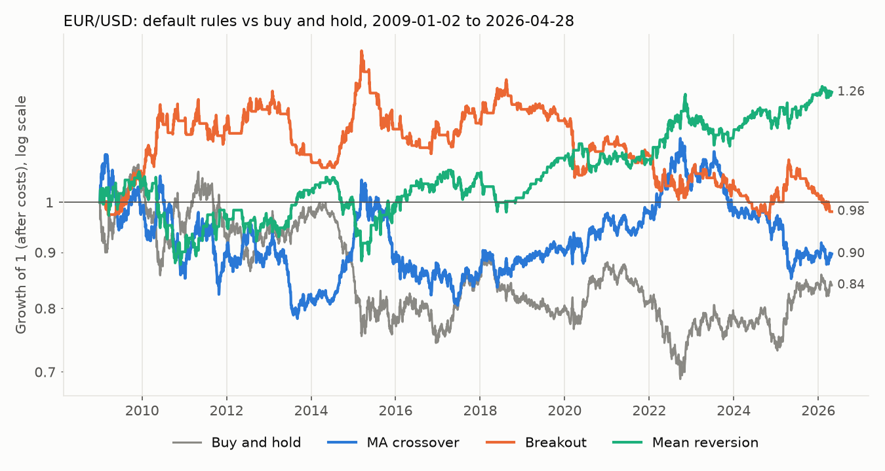
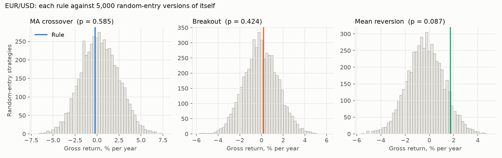
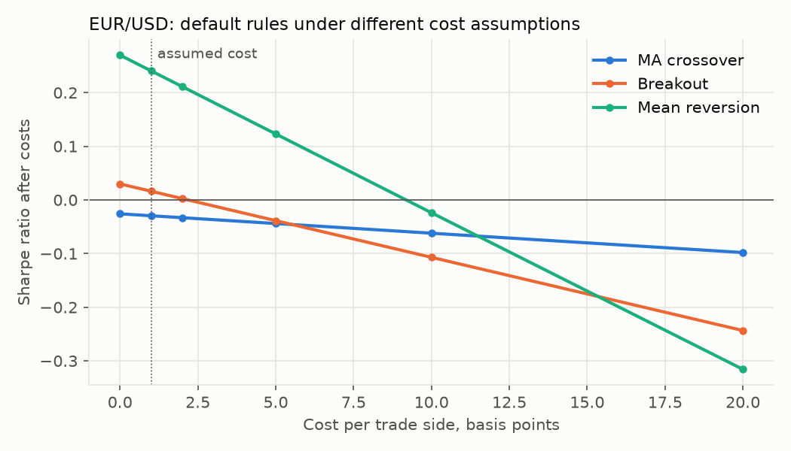
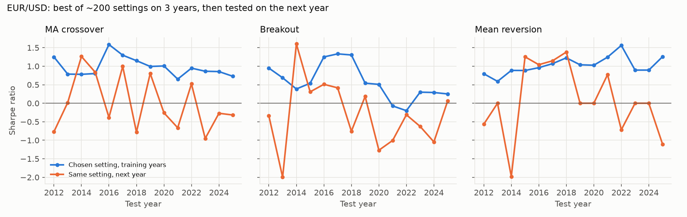
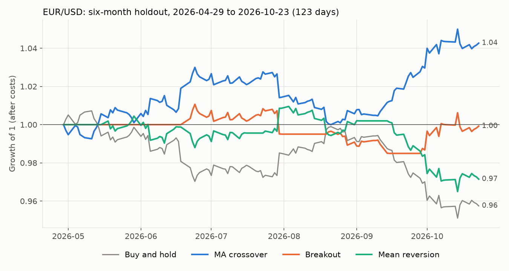
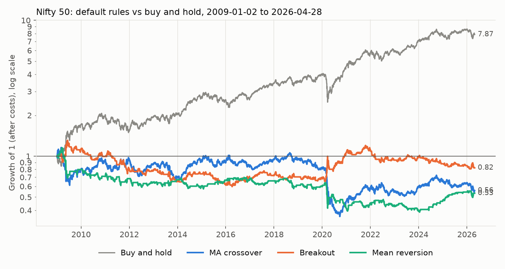
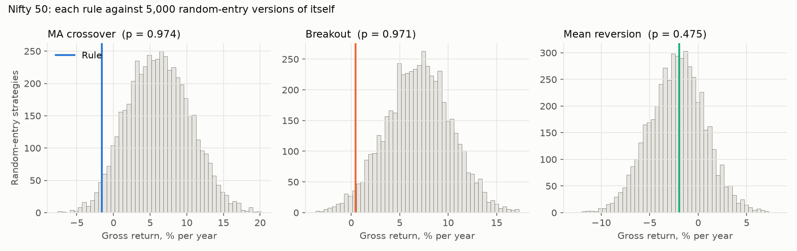
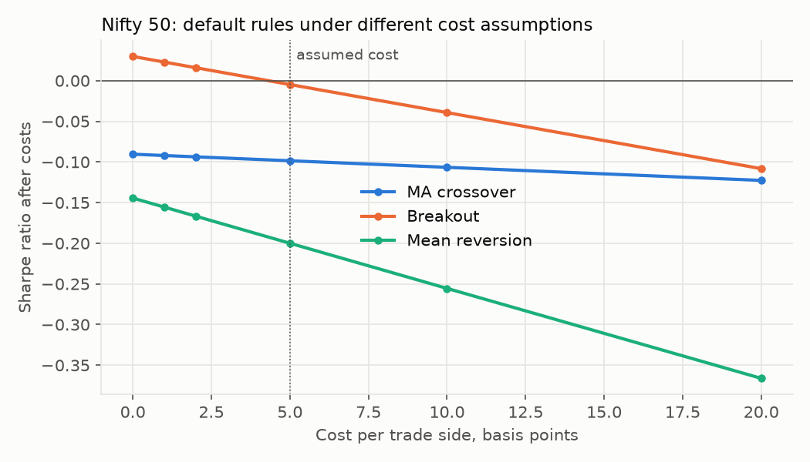
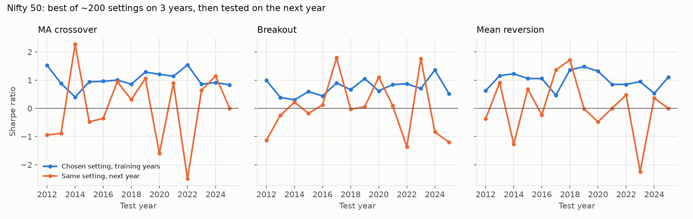
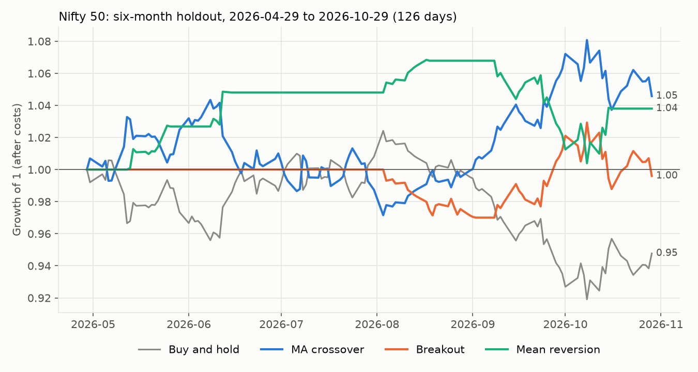

# Results

Generated by `python -m skill_or_luck run`. All figures are backtests on historical data, not live trading results.

Design: default parameters were fixed before any backtest. Main sample starts 2009-01-01; data from 2026-04-29 is a holdout that is computed in every run but never used to choose anything.

- **EUR/USD**: FRED DEXUSEU via datahub.io mirror, inverted from EUR per USD (https://raw.githubusercontent.com/datasets/exchange-rates/c28e171e36a46bd2941cf66156acd8efaf9906f5/data/daily.csv), retrieved 2026-10-28 21:26 UTC
- **Nifty 50**: Yahoo Finance ^NSEI via yfinance, retrieved 2026-10-29 16:54 UTC

Python 3.14.6; numpy 2.5.4, pandas 3.1.0, scipy 1.18.1, matplotlib 3.11.2.

## EUR/USD

Main sample: 2009-01-02 to 2026-04-28 (4,334 daily prices). Holdout: 2026-04-29 to 2026-10-23 (123 prices). Assumed cost: 1 bp per trade side, including slippage. Sharpe ratios are annualised with a zero risk-free rate.

### Default rules on the main sample

| Rule | Parameters | CAGR | Sharpe | Sharpe 95% CI | Max drawdown | Time in market |
|---|---|---|---|---|---|---|
| Buy and hold | – | -1.0% | -0.07 | [-0.53, 0.38] | -36.3% | 100% |
| MA crossover | fast=50, slow=200 | -0.6% | -0.03 | [-0.49, 0.46] | -29.2% | 100% |
| Breakout | entry=55, exit=20 | -0.1% | 0.02 | [-0.47, 0.50] | -29.8% | 61% |
| Mean reversion | lookback=20, threshold=2.0 | 1.3% | 0.24 | [-0.21, 0.68] | -17.7% | 54% |

| Rule | Trades | Win rate | Win rate 95% CI | Avg trade | Avg trade 95% CI | Payoff ratio | Random-entry p | Trades needed |
|---|---|---|---|---|---|---|---|---|
| MA crossover | 27 | 29.6% | [14.8%, 48.1%] | -0.25% | [-2.18%, 2.13%] | 2.10 | 0.585 | – (avg trade ≤ 0) |
| Breakout | 79 | 34.2% | [24.1%, 44.3%] | 0.04% | [-0.70%, 0.90%] | 1.99 | 0.424 | 64,308 |
| Mean reversion | 163 | 66.9% | [59.5%, 73.6%] | 0.16% | [-0.13%, 0.42%] | 0.63 | 0.087 | 791 |

Random-entry p: share of random-timing versions (same trades, same holding periods, same time in market) that did at least as well, gross of costs. Trades needed: trades required for the observed average trade to be significant (5% one-sided, 80% power).

### Cost sensitivity (Sharpe after costs, default rules)

| Rule | 0 bp | 1 bp | 2 bp | 5 bp | 10 bp | 20 bp |
|---|---|---|---|---|---|---|
| Breakout | 0.03 | 0.02 | 0.00 | -0.04 | -0.11 | -0.24 |
| MA crossover | -0.03 | -0.03 | -0.03 | -0.04 | -0.06 | -0.10 |
| Mean reversion | 0.27 | 0.24 | 0.21 | 0.12 | -0.02 | -0.32 |

### Execution delay (Sharpe after costs, default rules)

| Rule | Fill at the decision price | Fill one day later |
|---|---|---|
| Breakout | 0.02 | -0.05 |
| MA crossover | -0.03 | -0.03 |
| Mean reversion | 0.24 | 0.13 |

### Overfitting: walk-forward test (3-year training window)

| Rule | Folds | Mean Sharpe, training years | Mean Sharpe, next year | Median setting, next year | Folds where next year was worse | Chosen setting's percentile next year | Rank correlation (train vs next year) | Stitched out-of-sample Sharpe |
|---|---|---|---|---|---|---|---|---|
| MA crossover | 14 | 0.98 | 0.00 | 0.10 | 86% | 42% | -0.13 | 0.01 |
| Breakout | 14 | 0.58 | -0.31 | -0.02 | 93% | 38% | -0.13 | -0.27 |
| Mean reversion | 14 | 1.02 | 0.09 | -0.05 | 71% | 45% | -0.04 | -0.17 |

### Deflated Sharpe ratio (all settings, main sample)

| Search | Settings tried | Best setting | Best Sharpe | Prob. Sharpe > 0 (PSR) | Sharpe expected from luck alone | Deflated Sharpe (prob. above luck) |
|---|---|---|---|---|---|---|
| MA crossover | 215 | MA crossover (fast=30, slow=120) | 0.39 | 94.8% | 0.30 | 64.3% |
| Breakout | 199 | Breakout (entry=220, exit=5) | 0.27 | 87.2% | 0.22 | 58.3% |
| Mean reversion | 214 | Mean reversion (lookback=20, threshold=3.0) | 0.53 | 99.0% | 0.38 | 73.7% |
| all three rules | 628 | Mean reversion (lookback=20, threshold=3.0) | 0.53 | 99.0% | 0.40 | 71.7% |

### Six-month holdout

| Rule | Parameters | Chosen by | Return | Sharpe | Sharpe 95% CI | Trades |
|---|---|---|---|---|---|---|
| Buy and hold | – | - | -4.25% | -1.72 | – | 1 |
| MA crossover | fast=50, slow=200 | default | 4.27% | 1.70 | [-1.25, 4.64] | 1 |
| MA crossover | fast=5, slow=20 | tuned on previous 3 years | 1.52% | 0.63 | [-2.78, 3.62] | 10 |
| Breakout | entry=55, exit=20 | default | -0.08% | -0.02 | [-2.10, 1.77] | 3 |
| Breakout | entry=20, exit=5 | tuned on previous 3 years | 4.33% | 2.40 | [0.17, 4.57] | 5 |
| Mean reversion | lookback=20, threshold=2.0 | default | -2.85% | -1.28 | [-3.65, 0.98] | 5 |
| Mean reversion | lookback=100, threshold=2.0 | tuned on previous 3 years | 1.40% | 0.88 | [-0.60, 2.38] | 2 |

## Nifty 50

Main sample: 2009-01-02 to 2026-04-28 (4,247 daily prices). Holdout: 2026-04-29 to 2026-10-29 (126 prices). Assumed cost: 5 bp per trade side, including slippage. Sharpe ratios are annualised with a zero risk-free rate.

### Default rules on the main sample

| Rule | Parameters | CAGR | Sharpe | Sharpe 95% CI | Max drawdown | Time in market |
|---|---|---|---|---|---|---|
| Buy and hold | – | 12.7% | 0.76 | [0.27, 1.24] | -38.4% | 100% |
| MA crossover | fast=50, slow=200 | -3.3% | -0.10 | [-0.56, 0.42] | -68.9% | 100% |
| Breakout | entry=55, exit=20 | -1.1% | -0.00 | [-0.52, 0.47] | -54.4% | 66% |
| Mean reversion | lookback=20, threshold=2.0 | -3.6% | -0.20 | [-0.65, 0.30] | -66.4% | 46% |

| Rule | Trades | Win rate | Win rate 95% CI | Avg trade | Avg trade 95% CI | Payoff ratio | Random-entry p | Trades needed |
|---|---|---|---|---|---|---|---|---|
| MA crossover | 25 | 32.0% | [16.0%, 52.0%] | -0.57% | [-7.79%, 6.96%] | 1.95 | 0.974 | – (avg trade ≤ 0) |
| Breakout | 88 | 40.9% | [30.7%, 51.1%] | -0.07% | [-1.20%, 1.20%] | 1.40 | 0.971 | – (avg trade ≤ 0) |
| Mean reversion | 130 | 63.8% | [55.4%, 72.3%] | -0.32% | [-1.27%, 0.50%] | 0.46 | 0.475 | – (avg trade ≤ 0) |

Random-entry p: share of random-timing versions (same trades, same holding periods, same time in market) that did at least as well, gross of costs. Trades needed: trades required for the observed average trade to be significant (5% one-sided, 80% power).

### Cost sensitivity (Sharpe after costs, default rules)

| Rule | 0 bp | 1 bp | 2 bp | 5 bp | 10 bp | 20 bp |
|---|---|---|---|---|---|---|
| Breakout | 0.03 | 0.02 | 0.02 | -0.00 | -0.04 | -0.11 |
| MA crossover | -0.09 | -0.09 | -0.09 | -0.10 | -0.11 | -0.12 |
| Mean reversion | -0.14 | -0.16 | -0.17 | -0.20 | -0.26 | -0.37 |

### Execution delay (Sharpe after costs, default rules)

| Rule | Fill at the decision price | Fill one day later |
|---|---|---|
| Breakout | -0.00 | -0.07 |
| MA crossover | -0.10 | -0.07 |
| Mean reversion | -0.20 | -0.13 |

### Overfitting: walk-forward test (3-year training window)

| Rule | Folds | Mean Sharpe, training years | Mean Sharpe, next year | Median setting, next year | Folds where next year was worse | Chosen setting's percentile next year | Rank correlation (train vs next year) | Stitched out-of-sample Sharpe |
|---|---|---|---|---|---|---|---|---|
| MA crossover | 14 | 1.03 | 0.04 | 0.13 | 86% | 45% | -0.11 | -0.20 |
| Breakout | 14 | 0.73 | 0.01 | 0.07 | 79% | 52% | -0.02 | 0.04 |
| Mean reversion | 14 | 1.00 | 0.06 | -0.16 | 86% | 50% | 0.12 | -0.03 |

### Deflated Sharpe ratio (all settings, main sample)

| Search | Settings tried | Best setting | Best Sharpe | Prob. Sharpe > 0 (PSR) | Sharpe expected from luck alone | Deflated Sharpe (prob. above luck) |
|---|---|---|---|---|---|---|
| MA crossover | 215 | MA crossover (fast=70, slow=80) | 0.43 | 96.6% | 0.39 | 56.5% |
| Breakout | 199 | Breakout (entry=70, exit=50) | 0.31 | 90.4% | 0.27 | 56.9% |
| Mean reversion | 214 | Mean reversion (lookback=40, threshold=2.75) | 0.10 | 65.8% | 0.36 | 13.6% |
| all three rules | 628 | MA crossover (fast=70, slow=80) | 0.43 | 96.6% | 0.52 | 34.9% |

### Six-month holdout

| Rule | Parameters | Chosen by | Return | Sharpe | Sharpe 95% CI | Trades |
|---|---|---|---|---|---|---|
| Buy and hold | – | - | -5.23% | -0.84 | – | 1 |
| MA crossover | fast=50, slow=200 | default | 4.58% | 0.81 | [-1.28, 3.34] | 1 |
| MA crossover | fast=15, slow=60 | tuned on previous 3 years | 4.84% | 0.85 | [-0.87, 2.58] | 3 |
| Breakout | entry=55, exit=20 | default | -0.40% | -0.07 | [-3.54, 2.19] | 2 |
| Breakout | entry=250, exit=100 | tuned on previous 3 years | -3.28% | -1.33 | [-2.49, 0.14] | 1 |
| Mean reversion | lookback=20, threshold=2.0 | default | 3.80% | 0.98 | [-1.65, 4.41] | 4 |
| Mean reversion | lookback=25, threshold=2.25 | tuned on previous 3 years | -0.09% | 0.00 | [-2.06, 4.24] | 2 |

## Power analysis (no data needed)

Significance level 5%, power 80%, normal approximation; equal-sized wins and losses for the win-rate rows.

| Edge to detect | Test | Trades needed |
|---|---|---|
| 52% win rate vs 50% | one-sided | 3,863 |
| 52% win rate vs 50% | two-sided | 4,904 |
| 55% win rate vs 50% | one-sided | 617 |
| 55% win rate vs 50% | two-sided | 783 |

| True annual Sharpe | Years of daily data needed |
|---|---|
| 0.25 | 98.9 |
| 0.5 | 24.7 |
| 1.0 | 6.2 |
| 2.0 | 1.5 |
